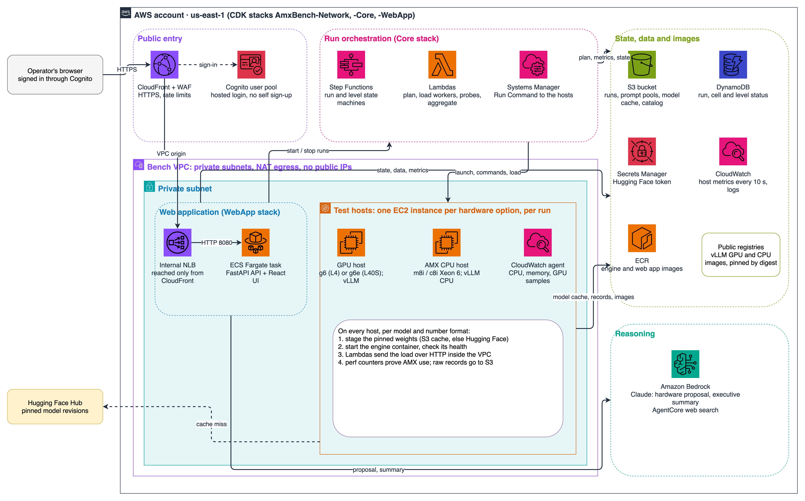

# amx-gpu-bench

**Should this model run on a GPU, or on an Intel CPU with AMX?** This tool answers with measurements taken in
your own AWS account, and explains the result in plain language.

It runs the same model on an NVIDIA GPU instance and on an Intel Xeon instance with AMX, under the same load,
with the same serving software on both sides. It proves that the CPU really used its AMX units, and reports
throughput, responsiveness, accuracy, cost per unit of work, and the load range in which each option is the
cheaper choice. A web application drives everything: a seven-step wizard to set up a benchmark, live progress,
a results page that opens with **Where the CPU is the better choice**, and an executive summary written for
product readers.



---

## Who are you?

| You are… | Start with |
|---|---|
| A **product or business reader** who wants to understand the question and read results | The [User guide](docs/USER_GUIDE.md): the problem, every screen, how to read the findings. It is also the **User guide** page inside the application. |
| An **operator** who will deploy the tool and run benchmarks | This page. [Get it running](#get-it-running-in-your-aws-account) takes you from an empty account to a signed-in application. |
| An **engineer** who wants to know how the measurements are taken | The [Operator reference](docs/REFERENCE.md), and the **Technical details** page inside the application. |

---

## What you get

- **A verdict per model**, in one sentence, with the GPU and the CPU side by side.
- **"At your load"**: enter the traffic you need to serve and the prices you pay, and read which option is
  cheaper, by how much, and at what load the answer flips.
- **Proof, not opinion**: every CPU result carries an AMX verification (hardware counters and an engine trace),
  every answer is checked for quality against the GPU, and every report explains *why* the numbers came out the
  way they did.
- **An executive summary**, 450 words with the exact numbers, written by a reasoning model on Amazon Bedrock
  from the computed findings.
- **A comparison of runs**, side by side, with a check that the runs are actually comparable.

---

## What it measures

| Use case | What runs | What you learn |
|---|---|---|
| **Chat and text generation** | Qwen3-1.7B, Gemma 4 E4B and E2B | Latency (P50/P99), tokens per second, cost per million tokens, answer quality against the GPU |
| **Sensitive-data detection (DSPM / DLP)** | Classifiers and decision models over 3,000 synthetic documents | Documents per second, recall and false-positive rate with confidence intervals, inline-DLP latency |
| **Translation** | English ⇄ German, English ⇄ Spanish | Characters per second, cost per million characters, translation quality (chrF) |
| **Embeddings** | EmbeddingGemma 300M in three languages | Embeddings per second, cost per million, agreement with the GPU's vectors, retrieval recall |
| **Agent decisions** | Strands Decider (E4B and 12B) | Decisions per second, accuracy, calibrated confidence |
| **Intel's benchmark, reproduced** | Intel's published Xeon method | Your run next to Intel's own published figures, per core |

GPU side: g6 (L4), g6e (L40S), g5. CPU side: m8i, c8i and the other AMX families. The hardware is paired fairly
(hourly prices within half to double of each other), and a reasoning model proposes the pair for each model,
taking your earlier runs into account.

---

## What it has found so far

- **Peak throughput per dollar goes to the GPU**, on every workload measured: 4x to 16x depending on the task.
  One L4 carries about 7.5x the arithmetic and 2.7x the memory bandwidth of the eight Xeon cores that cost the
  same per hour.
- **The CPU wins at low and moderate load.** Below a crossover the results page computes for your traffic, the
  cheapest option that still meets your targets is a CPU instance, often a small one.
- **The CPU also wins** when GPU capacity is refused, on the smallest unit you can buy, and on capacity you
  already pay for. The tool computes all of these from each run instead of asserting them.

Numbers, runs and sources: [What the CPU can and cannot win](docs/REFERENCE.md#15-what-the-cpu-can-and-cannot-win).

---

## Get it running in your AWS account

Nothing in the code names an AWS account. Everything deploys into **the account your AWS credentials point
at**; `aws sts get-caller-identity` shows which one that is.

### Before you start

| You need | Notes |
|---|---|
| An AWS account, with admin-level credentials in your shell | The account must be bootstrapped for CDK (`npx cdk bootstrap`, once). Region `us-east-1` by default. |
| Python 3.12, Node.js, Docker, `uv` | Docker builds the container images during the deploy; the first build pulls about 10 GB and needs ~30 GB free on the Docker disk. |
| About 45 minutes the first time | Most of it is building and pushing images. Later deploys take a few minutes. |
| An e-mail address and a password for the web app's first user | See [Sign in](#sign-in-user-name-and-password). The password needs 8+ characters with an upper-case letter, a lower-case letter, a digit and a symbol. |
| *Optional:* a Hugging Face read token | Only for the Gemma family of models. Everything else runs without one. See [Hugging Face token](#hugging-face-token-optional). |

### Step 1: one-time local setup

Run this once on the machine you deploy from:

```bash
git clone https://github.com/MichaelShapira/Amx.git amx-gpu-bench
cd amx-gpu-bench
python3.12 -m venv .venv
.venv/bin/pip install -e '.[dev]'
(cd infra && npm ci)
```

> [!NOTE]
> The CDK CLI is pinned in `infra/package.json`. Always call it as `npx cdk` from the `infra/` directory; a
> globally installed, older `cdk` cannot read this app.

### Step 2: deploy

Pick **one** of the two ways below. They produce the same deployment.

#### Option A: one command (recommended)

```bash
infra/deploy.sh --email you@example.com
```

The script asks you for the web app's password (typed hidden, not echoed) and then does everything:

1. Deploys the infrastructure stacks: `AmxBench-Network`, `AmxBench-Core`, and one `AmxBench-Target-<id>` for
   each hardware option.
2. Stores the Hugging Face token, if you gave one (`HF_TOKEN=hf_… infra/deploy.sh --email …`).
3. Deploys the web application (`AmxBench-WebApp`) and **creates your user** with the e-mail and password you
   provided.
4. Uploads the test data (prompt pools and datasets) the benchmarks need.

When the web app step finishes it prints the application's URL; keep that line:

```
done. Sign in at https://d1234abcd.cloudfront.net as you@example.com (hosted login; the password you provided is permanent).
```

Useful variants:

| Command | What it does |
|---|---|
| `HF_TOKEN=hf_… infra/deploy.sh --email you@example.com` | Also stores the Hugging Face token |
| `infra/deploy.sh --email you@example.com --hf-token-stdin < token.txt` | Same, token read from a file |
| `AMXBENCH_INITIAL_PASSWORD='…' infra/deploy.sh --email you@example.com` | Password from the environment instead of the prompt (for automation) |
| `infra/deploy.sh --stacks-only` | Infrastructure only, no web app, no user |
| `infra/deploy.sh --skip-stacks --email you@example.com` | Web app, user and test data against stacks that already exist |

#### Option B: step by step

The same four steps, run by hand. Use this when you want to see each change before it is applied, or when
only one part needs redeploying.

**B1. Infrastructure stacks.** Review the change, then deploy. The four shipped hardware options are listed
here; leave out the ones you do not want.

```bash
cd infra
npx cdk diff   AmxBench-Network AmxBench-Core AmxBench-Target-t1-g6 AmxBench-Target-t2-m8i-4xl AmxBench-Target-t2-c8i-4xl AmxBench-Target-t2-m8i-8xl
npx cdk deploy AmxBench-Network AmxBench-Core AmxBench-Target-t1-g6 AmxBench-Target-t2-m8i-4xl AmxBench-Target-t2-c8i-4xl AmxBench-Target-t2-m8i-8xl
cd ..
```

**B2. Hugging Face token** (optional, skip if you will not run Gemma models):

```bash
.venv/bin/bench hf-token --stdin < token.txt
```

**B3. Web application and its first user.** This deploys `AmxBench-WebApp`, then creates the user. You are
prompted for the password.

```bash
infra/deploy_webapp.sh --email you@example.com
```

**B4. Test data:**

```bash
.venv/bin/bench upload-artifacts
```

> [!TIP]
> An account that already had the secret `amx-gpu-bench/hf-token` before this version (created by hand) must
> import it rather than create a new one: add `-c hf_secret_arn=<its full ARN>` to every `cdk deploy` of
> `AmxBench-Core`. A fresh account needs nothing.

### Sign in: user name and password

> [!IMPORTANT]
> **Your user name is the e-mail address you passed with `--email`. Your password is the one you typed when
> the deploy script asked for it.** There is no sign-up page and no invitation e-mail: the deploy creates the
> account directly, and the password is permanent, so the first sign-in does not ask you to change it.

Open the URL the deploy printed (or read it any time with
`aws cloudformation describe-stacks --stack-name AmxBench-WebApp --query 'Stacks[0].Outputs'`). The Cognito
hosted sign-in page appears; enter the e-mail and password. The user the deploy creates is an **operator**: it
can start, stop and delete benchmarks and change settings.

| To… | Run |
|---|---|
| Add another operator | `infra/deploy_webapp.sh --email colleague@example.com --no-deploy` (prompts for their password; nothing is redeployed) |
| Reset a password | The same command with the existing e-mail. The new password is permanent, effective at once. |
| Give someone read-only access | Create the user in the Cognito console (user pool `amx-gpu-bench`), without adding them to the `operators` group. Any signed-in user can read; only operators can change things. |
| Give the password without typing it | `AMXBENCH_INITIAL_PASSWORD='…'` in the environment (works with both scripts), or `infra/deploy_webapp.sh --email … --password-stdin < pw.txt` |

The password never appears on a command line, in the repository, in CloudFormation or in any log.

### Hugging Face token (optional)

Some models are **gated** on huggingface.co: Gemma 4 E4B and E2B, EmbeddingGemma, and the Strands Deciders
(built on Gemma). To run them, accept their license on huggingface.co once and give the tool a **read** token
of that account (Hugging Face → Settings → Access Tokens). Qwen3, RoBERTa and the other models run without one.

The token lives in the Secrets Manager secret `amx-gpu-bench/hf-token`, which the deploy creates empty. Set it
whenever you like, in any of three equivalent ways:

| When | How |
|---|---|
| During the deploy | `HF_TOKEN=hf_… infra/deploy.sh --email …`, or `--hf-token-stdin < token.txt` |
| From the application | **Setup → Hugging Face token**: paste it, press *Save token*. The badge then reads *Set · last changed …* |
| From a shell, any time | `.venv/bin/bench hf-token --stdin < token.txt`. Without input, `bench hf-token` reports whether a token is stored. |

The tool checks the token's shape, asks huggingface.co whose token it is, and only then stores it. Before a run
with a gated model, the pre-check verifies that the stored token reaches that model and refuses the run with a
plain sentence otherwise. The value is never printed, logged or written to S3. To rotate it, store the new one
the same way; hosts pick it up on their next model download.

### What it costs to leave it deployed

- **While nothing runs:** roughly $3–4 a day. That is the NAT gateway ($0.045/hour), the web app's one
  always-on Fargate task, its internal load balancer, and WAF. No benchmark instance exists until a run starts
  one.
- **Per benchmark:** the instance hours it uses, at On-Demand or Spot prices, plus the load generators. A quick
  check costs about $1; a full multi-model study tens to a few hundred dollars. The wizard shows an estimate
  before you start.
- **Nothing is left running by accident.** Every run terminates its own instances when it ends, **Stop** and
  **Delete** terminate them at once, and a reaper terminates anything idle for 30 minutes or up for 8 hours
  with no live run.

Every resource carries the tag `Amx=amx-gpu-bench`, activated as a cost allocation tag, so the project's whole
spend can be read in Cost Explorer. Activation needs one follow-up a day after the first deploy; see
[Tags and cost allocation](docs/REFERENCE.md#10-tags-and-cost-allocation).

---

## Run your first benchmark

**In the web application** (the normal way):

1. Sign in and open **New benchmark**.
2. Pick a use case, look at the test data preview, and choose **Quick check**.
3. Pick a model. Qwen3-1.7B needs no token.
4. On the hardware step, accept the proposed GPU/CPU pair (or change it), choose Spot or On-Demand.
5. Set the load and the targets, review the estimate, and press **Start**.

The **Runs** page shows each hardware option coming up, the model loading, and every measurement's progress. A
quick check typically takes 30–45 minutes, most of it starting instances and loading the model. When it finishes, open
**Results**: the verdict is at the top, **At your load** is below it, and **Executive summary** writes the
one-page version. The [User guide](docs/USER_GUIDE.md) explains every screen and every number.

**From the command line** (the same engine, for scripting):

```bash
.venv/bin/bench validate config/runs/smoke-m1.yaml      # offline: cells, levels, pool sizes
.venv/bin/bench plan     config/runs/smoke-m1.yaml      # duration and cost estimate
.venv/bin/bench run      config/runs/smoke-m1.yaml      # starts the run
.venv/bin/bench status   <run-id>
.venv/bin/bench report   <run-id> --out reports/<run-id>
.venv/bin/bench stop     <run-id> --yes                  # finished measurements are kept
```

---

## Everyday operations

| Task | How |
|---|---|
| Update to a newer version | `git pull`, then `infra/deploy.sh --email you@example.com` again (it asks for the password; the same one is fine). Or redeploy one part with the step-by-step commands. |
| Add or remove a model | **Setup → Models** in the application: paste a Hugging Face repository id. Pools are built and the catalog updated in place. |
| Change the reasoning model | **Setup → Reasoning model** (the Claude and OpenAI models your account can call on Bedrock). |
| Activate the cost allocation tag | Open Cost Explorer once in the console; a day after the first deploy run `cd infra && npx cdk deploy AmxBench-Core -c cost_tag_revision=2`. |
| Add a hardware option | Add it to `config/targets.yaml`, then deploy its `AmxBench-Target-<id>` stack. |
| Run the application on your own machine instead | `webui/start.sh`, with your credentials; see [the reference](docs/REFERENCE.md#9-running-the-web-application-on-your-own-machine). |

---

## Removing it

```bash
cd infra
npx cdk destroy AmxBench-WebApp AmxBench-Target-t1-g6 AmxBench-Target-t2-m8i-4xl AmxBench-Target-t2-c8i-4xl AmxBench-Target-t2-m8i-8xl
npx cdk destroy AmxBench-Core AmxBench-Network
```

Kept on purpose, because they hold your results and your accounts: the S3 bucket, the DynamoDB table, the
Hugging Face token secret and the Cognito user pool. Delete them by hand when they are no longer needed.
Container images stay in the CDK bootstrap repository.

---

## Documentation

| Document | For |
|---|---|
| [User guide](docs/USER_GUIDE.md) | Product readers: the problem, every screen, how to read results. Also inside the app. |
| [Operator reference](docs/REFERENCE.md) | Operators and engineers: IAM, what a deploy creates, Spot handling, tags and cost, methodology, the suites in detail, security. |
| [Recipe check](docs/recipe-check-2026-11-19.md) | The CPU configuration checked against Intel's own published recipe. |
| **Technical details** page in the app | The method, down to the exact container images. |
| [Specification](.kiro/specs/cpu-amx-vs-gpu-inference/) | Requirements, design and task history. |

---

## Security, in short

Test hosts live in a private subnet with no public address and are reached only through SSM. The web app
sits behind CloudFront, AWS WAF and Cognito; nobody can sign up, and only operators can change anything. The
bucket blocks public access and requires TLS. Secrets (the Hugging Face token, the web app password) are never
written to the repository, to CloudFormation or to logs. Details: [Security](docs/REFERENCE.md#17-security).

---

## License

Public domain, under [The Unlicense](LICENSE): no copyright is claimed and no attribution is required. Written
by Michael Shapira.

The models, container images and datasets the tool downloads keep their own licenses; the catalog records each
model's, and a research-only license is shown on the model card and in the report.
