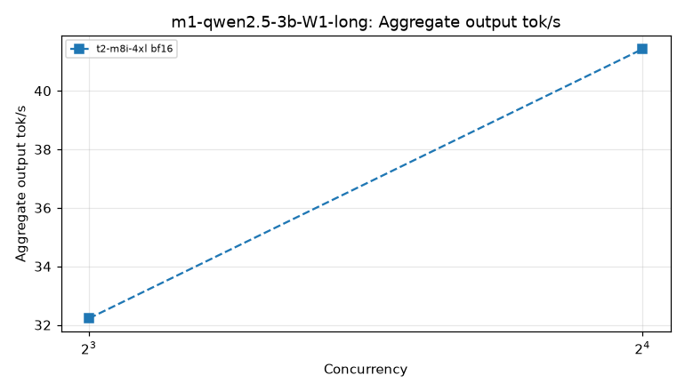
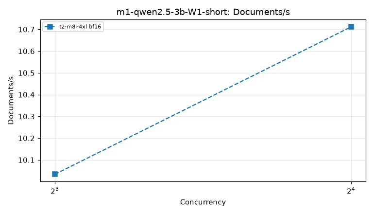
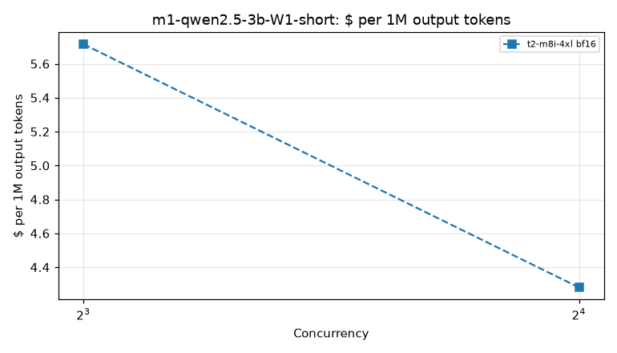
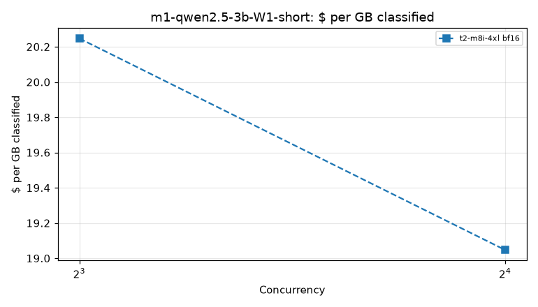
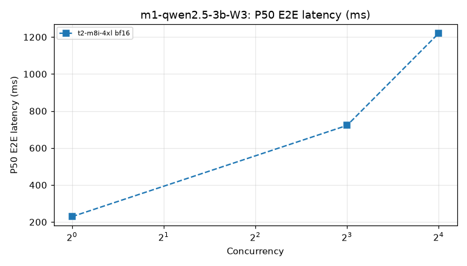
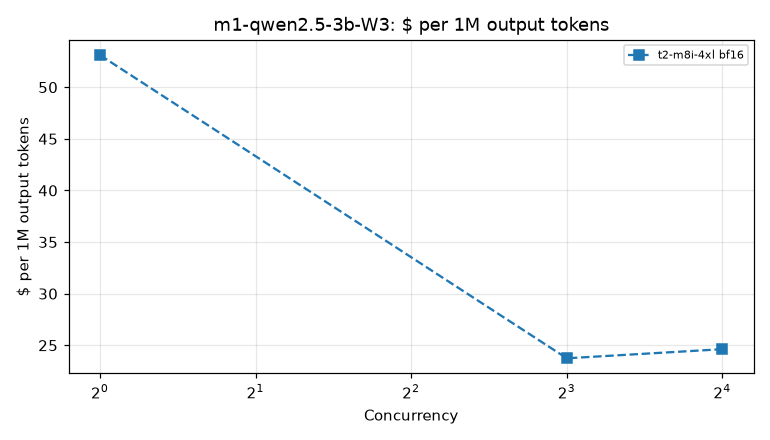

# Benchmark report: dspm-smoke-m1 (dspm-smoke-m1-20261110T083547Z)

> **SMOKE RUN.** Fewer requests and repeats than the methodology defaults. Use these numbers to check the harness, not to decide.

Suite **dspm**, region us-east-1 (use1-az1). Prices are On-Demand from the AWS Price List API; $/unit figures assume the instance is held at that load for a whole hour. Capacity, not cost, decides the verdict.

## m1-qwen2.5-3b W1-long

| Target | Instance | Engine | Precision | C | E2E P1/P50/P99 ms | docs/s | err % | $/hr | $/1M docs | $/GB | GB/h | AMX | Q delta | SLA |
|---|---|---|---|---|---|---|---|---|---|---|---|---|---|---|
| t2-m8i-4xl | m8i.4xlarge | vllm | bf16 | 8 | 464/928/1,083 | 7.9 | 0.00 | 0.847 | 29.60 | 4.2481 | 0.199 | VERIFIED | - | meets |
| t2-m8i-4xl | m8i.4xlarge | vllm | bf16 | 16 | 510/1,418/1,482 | 8.0 | 0.00 | 0.847 | 29.40 | 4.2070 | 0.201 | VERIFIED | - | **cheapest CPU meeting SLA** |

_no GPU row meets the SLA; capacity equivalence not computed_

## m1-qwen2.5-3b W1-short

| Target | Instance | Engine | Precision | C | E2E P1/P50/P99 ms | docs/s | err % | $/hr | $/1M docs | $/GB | GB/h | AMX | Q delta | SLA |
|---|---|---|---|---|---|---|---|---|---|---|---|---|---|---|
| t2-m8i-4xl | m8i.4xlarge | vllm | bf16 | 8 | 401/718/874 | 10.0 | 0.00 | 0.847 | 23.44 | 20.2471 | 0.042 | VERIFIED | - | meets |
| t2-m8i-4xl | m8i.4xlarge | vllm | bf16 | 16 | 422/1,048/1,215 | 10.7 | 0.00 | 0.847 | 21.96 | 19.0469 | 0.044 | VERIFIED | - | **cheapest CPU meeting SLA** |

_no GPU row meets the SLA; capacity equivalence not computed_

## m1-qwen2.5-3b W3

| Target | Instance | Engine | Precision | C | E2E P1/P50/P99 ms | docs/s | err % | $/hr | $/1M docs | $/GB | GB/h | AMX | Q delta | SLA |
|---|---|---|---|---|---|---|---|---|---|---|---|---|---|---|
| t2-m8i-4xl | m8i.4xlarge | vllm | bf16 | 1 | 174/229/268 | 4.4 | 0.00 | 0.847 | 53.11 | 121.8486 | 0.007 | VERIFIED | - | meets |
| t2-m8i-4xl | m8i.4xlarge | vllm | bf16 | 8 | 315/722/839 | 9.4 | 0.00 | 0.847 | 24.90 | 55.3250 | 0.015 | VERIFIED | - | **cheapest CPU meeting SLA** |
| t2-m8i-4xl | m8i.4xlarge | vllm | bf16 | 16 | 308/1,220/1,239 | 9.3 | 0.00 | 0.847 | 25.37 | 58.2100 | 0.015 | VERIFIED | - | p99_e2e_ms 1239 > 1000 |

_no GPU row meets the SLA; capacity equivalence not computed_

## DSPM/DLP accuracy

Speed results transfer to fine-tuned models of the same architecture, size and precision; accuracy results do not. The public checkpoints here are zero-shot or policy-prompted and will score lower than a production model fine-tuned on the customer's data.

| Cell | Workload | n | Recall [95% CI] | FPR [95% CI] | Precision | F1 | Format adherence | Agreement with GPU | CPU qualifies | Fitness |
|---|---|---|---|---|---|---|---|---|---|---|
| m1-qwen2.5-3b t2-m8i-4xl bf16 | W1-long | 300 | 0.101 [0.062, 0.159] | 0.146 [0.098, 0.211] | 0.405 | 0.161 | 1.000 | - | - | below floors |
| m1-qwen2.5-3b t2-m8i-4xl bf16 | W1-short | 300 | 0.375 [0.300, 0.456] | 0.205 [0.149, 0.275] | 0.628 | 0.470 | 1.000 | - | - | below floors |
| m1-qwen2.5-3b t2-m8i-4xl bf16 | W3 | 300 | 0.747 [0.674, 0.808] | 0.176 [0.122, 0.247] | 0.825 | 0.784 | 1.000 | - | - | below floors |

### Hard negatives (false positive rate by type)

| Cell | Workload | Hard case | n | FPR |
|---|---|---|---|---|
| m1-qwen2.5-3b t2-m8i-4xl bf16 | W1-long | documentation-value | 7 | 0.000 |
| m1-qwen2.5-3b t2-m8i-4xl bf16 | W1-long | first-name-only | 6 | 0.333 |
| m1-qwen2.5-3b t2-m8i-4xl bf16 | W1-long | indirect-reference | 11 | 0.000 |
| m1-qwen2.5-3b t2-m8i-4xl bf16 | W1-long | look-alike-number | 4 | 0.000 |
| m1-qwen2.5-3b t2-m8i-4xl bf16 | W1-long | masked | 8 | 0.375 |
| m1-qwen2.5-3b t2-m8i-4xl bf16 | W1-long | number-without-keyword | 7 | 0.286 |
| m1-qwen2.5-3b t2-m8i-4xl bf16 | W1-long | public-business | 8 | 0.500 |
| m1-qwen2.5-3b t2-m8i-4xl bf16 | W1-long | topic-only | 3 | 0.333 |
| m1-qwen2.5-3b t2-m8i-4xl bf16 | W1-short | documentation-value | 6 | 0.000 |
| m1-qwen2.5-3b t2-m8i-4xl bf16 | W1-short | first-name-only | 9 | 0.444 |
| m1-qwen2.5-3b t2-m8i-4xl bf16 | W1-short | indirect-reference | 6 | 0.000 |
| m1-qwen2.5-3b t2-m8i-4xl bf16 | W1-short | look-alike-number | 8 | 0.250 |
| m1-qwen2.5-3b t2-m8i-4xl bf16 | W1-short | masked | 8 | 0.625 |
| m1-qwen2.5-3b t2-m8i-4xl bf16 | W1-short | number-without-keyword | 7 | 0.143 |
| m1-qwen2.5-3b t2-m8i-4xl bf16 | W1-short | public-business | 7 | 0.429 |
| m1-qwen2.5-3b t2-m8i-4xl bf16 | W1-short | topic-only | 7 | 0.143 |
| m1-qwen2.5-3b t2-m8i-4xl bf16 | W3 | documentation-value | 6 | 0.833 |
| m1-qwen2.5-3b t2-m8i-4xl bf16 | W3 | first-name-only | 6 | 0.167 |
| m1-qwen2.5-3b t2-m8i-4xl bf16 | W3 | indirect-reference | 4 | 0.250 |
| m1-qwen2.5-3b t2-m8i-4xl bf16 | W3 | look-alike-number | 7 | 0.286 |
| m1-qwen2.5-3b t2-m8i-4xl bf16 | W3 | masked | 7 | 0.429 |
| m1-qwen2.5-3b t2-m8i-4xl bf16 | W3 | number-without-keyword | 6 | 0.000 |
| m1-qwen2.5-3b t2-m8i-4xl bf16 | W3 | public-business | 7 | 0.000 |
| m1-qwen2.5-3b t2-m8i-4xl bf16 | W3 | topic-only | 8 | 0.250 |

Context, not like-for-like: Amazon Macie sensitive data discovery lists $1.00/GB for the first 50,000 GB per month (then $0.50 and $0.25); Google Sensitive Data Protection storage inspection lists $1.00/GiB up to 50 TiB. Both include connectors, file parsing and their own detectors; the figures here cover classification of already-extracted text only.

Dataset sources: NVIDIA Nemotron-PII (CC BY 4.0), Gretel synthetic_pii_finance_multilingual (Apache-2.0), and a seeded generator in this repository. All values are synthetic.

## Charts

## Price source

- g5.xlarge: $1.006/h, SKU 79BRGEEZC6TARVWJ, effective 2026-11-01T00:00:00Z, price list arn:aws:pricing:::price-list/aws/AmazonEC2/USD/20261107002852/us-east-1 (published 2026-11-07T00:28:52Z)
- g6.xlarge: $0.8048/h, SKU TPKUC6XYSUQ3VFK2, effective 2026-11-01T00:00:00Z, price list arn:aws:pricing:::price-list/aws/AmazonEC2/USD/20261107002852/us-east-1 (published 2026-11-07T00:28:52Z)
- m8i.4xlarge: $0.84672/h, SKU E7HS8NYMC36MBM9V, effective 2026-11-01T00:00:00Z, price list arn:aws:pricing:::price-list/aws/AmazonEC2/USD/20261107002852/us-east-1 (published 2026-11-07T00:28:52Z)

## Capacity errors seen while starting instances

- t1-g6: 2026-11-10T08:36:10Z InsufficientInstanceCapacity (g6.xlarge, None)
- t1-g6: 2026-11-10T08:37:25Z InsufficientInstanceCapacity (g6.xlarge, None)
- t1-g6: 2026-11-10T08:38:42Z InsufficientInstanceCapacity (g6.xlarge, None)
- t1-g6: 2026-11-10T08:39:58Z InsufficientInstanceCapacity (g5.xlarge, None)
- t1-g6: 2026-11-10T08:41:16Z InsufficientInstanceCapacity (g6.xlarge, None)
- t1-g6: 2026-11-10T08:42:28Z InsufficientInstanceCapacity (g5.xlarge, None)
- t1-g6: 2026-11-10T08:43:41Z InsufficientInstanceCapacity (g6.xlarge, None)
- t1-g6: 2026-11-10T08:44:51Z InsufficientInstanceCapacity (g5.xlarge, None)
- t1-g6: 2026-11-10T08:46:02Z InsufficientInstanceCapacity (g6.xlarge, None)
- t1-g6: 2026-11-10T08:47:11Z InsufficientInstanceCapacity (g5.xlarge, us-east-1a)
- t1-g6: 2026-11-10T08:48:22Z InsufficientInstanceCapacity (g6.xlarge, us-east-1a)
- t1-g6: 2026-11-10T08:49:32Z InsufficientInstanceCapacity (g5.xlarge, us-east-1a)
- t1-g6: 2026-11-10T08:50:45Z InsufficientInstanceCapacity (g6.xlarge, us-east-1a)
- t1-g6: 2026-11-10T08:51:58Z InsufficientInstanceCapacity (g5.xlarge, us-east-1a)
- t1-g6: 2026-11-10T08:53:13Z InsufficientInstanceCapacity (g6.xlarge, us-east-1a)
- t1-g6: 2026-11-10T08:54:25Z InsufficientInstanceCapacity (g5.xlarge, us-east-1a)
- t1-g6: 2026-11-10T08:55:36Z InsufficientInstanceCapacity (g6.xlarge, us-east-1a)
- t1-g6: 2026-11-10T08:56:46Z InsufficientInstanceCapacity (g5.xlarge, us-east-1a)
- t1-g6: 2026-11-10T08:58:00Z InsufficientInstanceCapacity (g6.xlarge, us-east-1a)
- t1-g6: 2026-11-10T08:59:18Z InsufficientInstanceCapacity (g5.xlarge, us-east-1a)
- t1-g6: 2026-11-10T09:00:33Z InsufficientInstanceCapacity (g6.xlarge, us-east-1a)
- t1-g6: 2026-11-10T09:01:44Z InsufficientInstanceCapacity (g5.xlarge, us-east-1a)
- t1-g6: 2026-11-10T09:02:56Z InsufficientInstanceCapacity (g6.xlarge, us-east-1a)
- t1-g6: 2026-11-10T09:04:05Z InsufficientInstanceCapacity (g5.xlarge, us-east-1a)
- t1-g6: 2026-11-10T09:05:16Z InsufficientInstanceCapacity (g6.xlarge, us-east-1a)

## Warnings

- SMOKE RUN: below the methodology defaults (200 requests x 3 repeats per level); numbers are indicative only.
- m1-qwen2.5-3b: license qwen-research is non-commercial; results are for evaluation only.

## Provenance

- run hash c62121e3c229e2a717063a1f3943ce2085ca7d8c3461cda9ae5a6d7f3d12bb85, models 0e7c5b311fde4429defd9403b108f1bd4539ab520b7f60aaf254930628f031a6, targets f062cab64b10cee1db8cd8723dbabfc2925223ff4c560eef063459c58214ecda
- harness commit e76c3b6dd625be7da405dd13d034cb550ea92da8
- AMIs {"t1-g6": "ami-0fa51b517f148a6a4", "t2-m8i-4xl": "ami-07c1b6f58fb89ce9f"}
- instances {"t2-m8i-4xl": ["i-0db1bda3d6322f398"]}, market {"t2-m8i-4xl": "spot"} (requested spot); cost columns use On-Demand prices
- pairing t2-m8i-4xl (m8i.4xlarge) vs t1-g6 (g6.xlarge): fair, GPU/CPU hourly price ratio 0.95
- DSPM dataset and policy {"dataset_manifest_sha256": "9c5655afbf543bac34148be1e0cb0f0105a25c58c3e294ea4acf80d58fdbb68f", "dataset_seed": 20261109, "dataset_sha256": "48a1b29544e6d012c558cbd20a538379fc93dcf1d3549bbe600316cea67d74df", "dataset_version": "v1", "policy_sha256": "193595d838c6b2b80dcdb4b01ba3bed84b04ee4073326e7233ef50f86663e9e0", "policy_short_sha256": "7dfe9035d73f0dab9a17a34bbcc662f5d5627be41309be791680761cc6cd86d4", "span_label_map_sha256": "b00ceeff8f62e1b9ea7c1fcbf64f49467144b76e69da3daf0fdc47767c38a41c", "version": "v1"}
