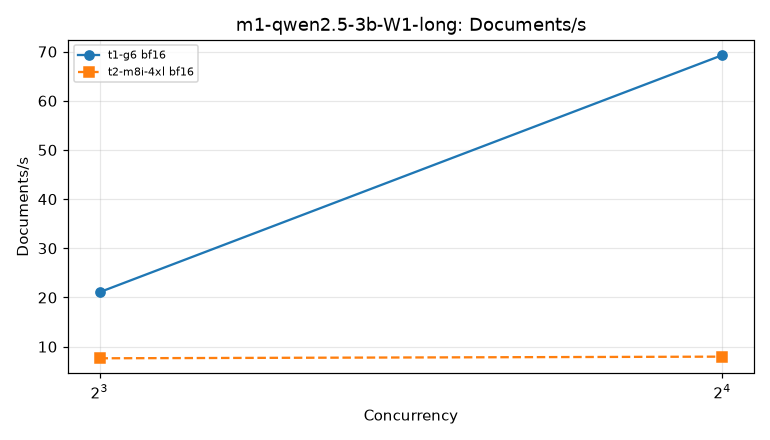
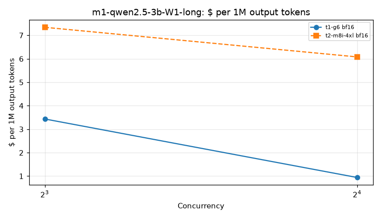
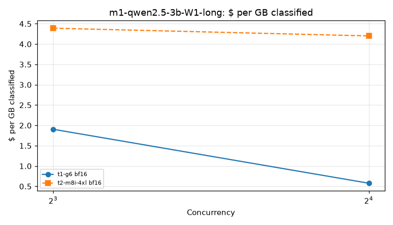
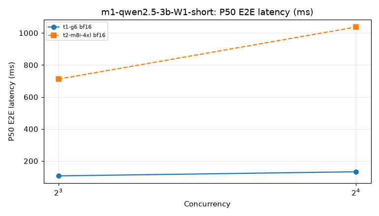
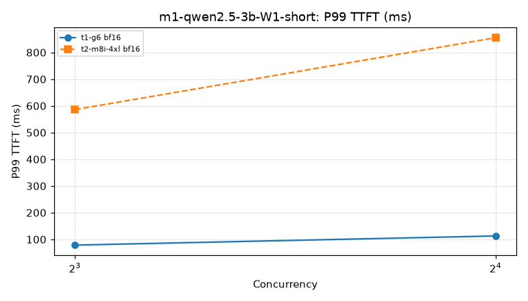
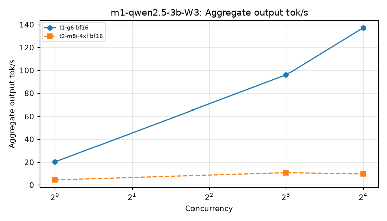
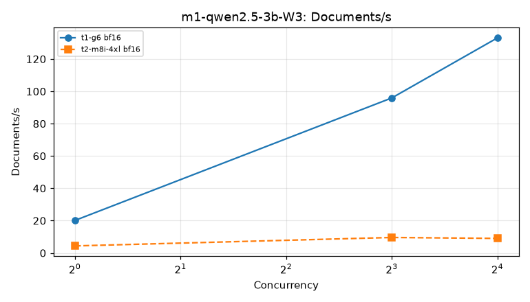
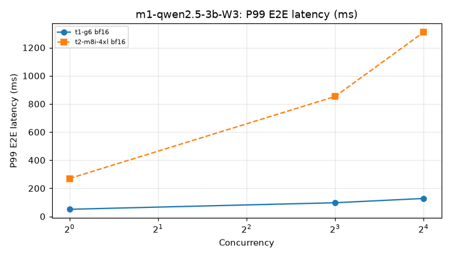
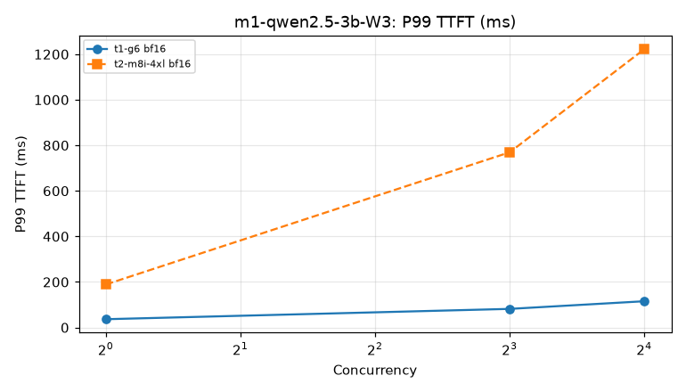
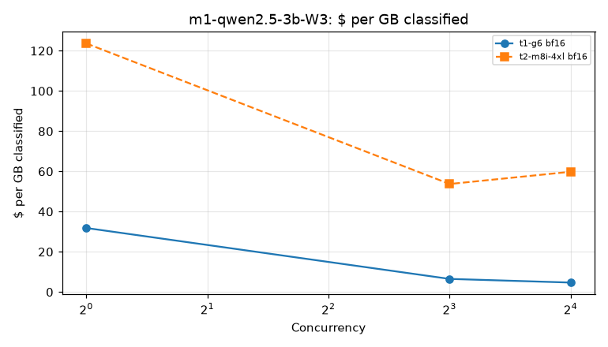

# Benchmark report: dspm-smoke-m1 (dspm-smoke-m1-20261110T113338Z)

> **SMOKE RUN.** Fewer requests and repeats than the methodology defaults. Use these numbers to check the harness, not to decide.

Suite **dspm**, region us-east-1 (use1-az1). Prices are On-Demand from the AWS Price List API; $/unit figures assume the instance is held at that load for a whole hour. Capacity, not cost, decides the verdict.

## m1-qwen2.5-3b W1-long

| Target | Instance | Engine | Precision | C | E2E P1/P50/P99 ms | docs/s | err % | $/hr | $/1M docs | $/GB | GB/h | AMX | Q delta | SLA |
|---|---|---|---|---|---|---|---|---|---|---|---|---|---|---|
| t1-g6 | g5.xlarge | vllm | bf16 | 8 | 100/321/846 | 21.1 | 0.00 | 1.006 | 13.26 | 1.9043 | 0.528 | n/a | - | meets |
| t1-g6 | g5.xlarge | vllm | bf16 | 16 | 100/171/280 | 69.3 | 0.00 | 1.006 | 4.03 | 0.5771 | 1.743 | n/a | - | **best GPU** |
| t2-m8i-4xl | m8i.4xlarge | vllm | bf16 | 8 | 529/953/1,022 | 7.6 | 0.00 | 0.847 | 30.80 | 4.3910 | 0.193 | VERIFIED | - | meets |
| t2-m8i-4xl | m8i.4xlarge | vllm | bf16 | 16 | 534/1,520/1,926 | 8.0 | 0.00 | 0.847 | 29.50 | 4.2008 | 0.202 | VERIFIED | - | **cheapest CPU meeting SLA** |

Capacity equivalence (CPU instances needed to match the best GPU row's SLA-meeting throughput):

| CPU instance | Engine | Precision | C | Instances per GPU | Standard vCPUs | G vCPUs (GPU) | Hourly cost ratio | Within limit |
|---|---|---|---|---|---|---|---|---|
| m8i.4xlarge | vllm | bf16 | 16 | 9 | 144 | 4 | 7.58 | no (Conditional) |
| m8i.4xlarge | vllm | bf16 | 8 | 10 | 160 | 4 | 8.42 | no (Conditional) |

## m1-qwen2.5-3b W1-short

| Target | Instance | Engine | Precision | C | E2E P1/P50/P99 ms | docs/s | err % | $/hr | $/1M docs | $/GB | GB/h | AMX | Q delta | SLA |
|---|---|---|---|---|---|---|---|---|---|---|---|---|---|---|
| t1-g6 | g5.xlarge | vllm | bf16 | 8 | 77/107/127 | 67.3 | 0.00 | 1.006 | 4.15 | 3.5827 | 0.281 | n/a | - | meets |
| t1-g6 | g5.xlarge | vllm | bf16 | 16 | 90/133/156 | 91.7 | 0.00 | 1.006 | 3.05 | 2.5760 | 0.391 | n/a | - | **best GPU** |
| t2-m8i-4xl | m8i.4xlarge | vllm | bf16 | 8 | 406/712/843 | 10.4 | 0.00 | 0.847 | 22.53 | 19.3578 | 0.044 | VERIFIED | - | recall drop 1.39 pp > 1.0 pp |
| t2-m8i-4xl | m8i.4xlarge | vllm | bf16 | 16 | 415/1,037/1,131 | 11.1 | 0.00 | 0.847 | 21.18 | 18.3244 | 0.046 | VERIFIED | - | recall drop 1.39 pp > 1.0 pp |

## m1-qwen2.5-3b W3

| Target | Instance | Engine | Precision | C | E2E P1/P50/P99 ms | docs/s | err % | $/hr | $/1M docs | $/GB | GB/h | AMX | Q delta | SLA |
|---|---|---|---|---|---|---|---|---|---|---|---|---|---|---|
| t1-g6 | g5.xlarge | vllm | bf16 | 1 | 47/50/51 | 20.1 | 0.00 | 1.006 | 13.87 | 31.8252 | 0.032 | n/a | - | meets |
| t1-g6 | g5.xlarge | vllm | bf16 | 8 | 62/77/97 | 95.9 | 0.00 | 1.006 | 2.91 | 6.5044 | 0.155 | n/a | - | meets |
| t1-g6 | g5.xlarge | vllm | bf16 | 16 | 64/95/128 | 133.1 | 0.00 | 1.006 | 2.10 | 4.6890 | 0.215 | n/a | - | **best GPU** |
| t2-m8i-4xl | m8i.4xlarge | vllm | bf16 | 1 | 174/233/270 | 4.4 | 0.00 | 0.847 | 53.89 | 123.6402 | 0.007 | VERIFIED | - | meets |
| t2-m8i-4xl | m8i.4xlarge | vllm | bf16 | 8 | 359/736/853 | 9.6 | 0.00 | 0.847 | 24.52 | 53.7279 | 0.016 | VERIFIED | - | **cheapest CPU meeting SLA** |
| t2-m8i-4xl | m8i.4xlarge | vllm | bf16 | 16 | 318/1,222/1,310 | 9.0 | 0.00 | 0.847 | 26.11 | 59.8075 | 0.014 | VERIFIED | - | p99_e2e_ms 1310 > 1000 |

Capacity equivalence (CPU instances needed to match the best GPU row's SLA-meeting throughput):

| CPU instance | Engine | Precision | C | Instances per GPU | Standard vCPUs | G vCPUs (GPU) | Hourly cost ratio | Within limit |
|---|---|---|---|---|---|---|---|---|
| m8i.4xlarge | vllm | bf16 | 1 | 31 | 496 | 4 | 26.09 | no (Conditional) |
| m8i.4xlarge | vllm | bf16 | 8 | 14 | 224 | 4 | 11.78 | no (Conditional) |

## DSPM/DLP accuracy

Speed results transfer to fine-tuned models of the same architecture, size and precision; accuracy results do not. The public checkpoints here are zero-shot or policy-prompted and will score lower than a production model fine-tuned on the customer's data.

| Cell | Workload | n | Recall [95% CI] | FPR [95% CI] | Precision | F1 | Format adherence | Agreement with GPU | CPU qualifies | Fitness |
|---|---|---|---|---|---|---|---|---|---|---|
| m1-qwen2.5-3b t1-g6 bf16 | W1-long | 300 | 0.114 [0.072, 0.175] | 0.139 [0.093, 0.203] | 0.447 | 0.182 | 1.000 | - | - | below floors |
| m1-qwen2.5-3b t1-g6 bf16 | W1-short | 300 | 0.382 [0.307, 0.463] | 0.218 [0.160, 0.289] | 0.618 | 0.472 | 1.000 | - | - | below floors |
| m1-qwen2.5-3b t1-g6 bf16 | W3 | 300 | 0.741 [0.667, 0.803] | 0.176 [0.122, 0.247] | 0.824 | 0.780 | 1.000 | - | - | below floors |
| m1-qwen2.5-3b t2-m8i-4xl bf16 | W1-long | 300 | 0.114 [0.072, 0.175] | 0.139 [0.093, 0.203] | 0.447 | 0.182 | 1.000 | 0.993 | yes | below floors |
| m1-qwen2.5-3b t2-m8i-4xl bf16 | W1-short | 300 | 0.368 [0.294, 0.449] | 0.205 [0.149, 0.275] | 0.624 | 0.463 | 1.000 | 0.987 | recall drop 1.39 pp > 1.0 pp | below floors |
| m1-qwen2.5-3b t2-m8i-4xl bf16 | W3 | 300 | 0.747 [0.674, 0.808] | 0.169 [0.116, 0.239] | 0.831 | 0.787 | 1.000 | 0.993 | yes | below floors |

### Hard negatives (false positive rate by type)

| Cell | Workload | Hard case | n | FPR |
|---|---|---|---|---|
| m1-qwen2.5-3b t1-g6 bf16 | W1-long | documentation-value | 7 | 0.000 |
| m1-qwen2.5-3b t1-g6 bf16 | W1-long | first-name-only | 6 | 0.333 |
| m1-qwen2.5-3b t1-g6 bf16 | W1-long | indirect-reference | 11 | 0.000 |
| m1-qwen2.5-3b t1-g6 bf16 | W1-long | look-alike-number | 4 | 0.000 |
| m1-qwen2.5-3b t1-g6 bf16 | W1-long | masked | 8 | 0.375 |
| m1-qwen2.5-3b t1-g6 bf16 | W1-long | number-without-keyword | 7 | 0.286 |
| m1-qwen2.5-3b t1-g6 bf16 | W1-long | public-business | 8 | 0.500 |
| m1-qwen2.5-3b t1-g6 bf16 | W1-long | topic-only | 3 | 0.333 |
| m1-qwen2.5-3b t1-g6 bf16 | W1-short | documentation-value | 6 | 0.000 |
| m1-qwen2.5-3b t1-g6 bf16 | W1-short | first-name-only | 9 | 0.444 |
| m1-qwen2.5-3b t1-g6 bf16 | W1-short | indirect-reference | 6 | 0.000 |
| m1-qwen2.5-3b t1-g6 bf16 | W1-short | look-alike-number | 8 | 0.250 |
| m1-qwen2.5-3b t1-g6 bf16 | W1-short | masked | 8 | 0.625 |
| m1-qwen2.5-3b t1-g6 bf16 | W1-short | number-without-keyword | 7 | 0.143 |
| m1-qwen2.5-3b t1-g6 bf16 | W1-short | public-business | 7 | 0.429 |
| m1-qwen2.5-3b t1-g6 bf16 | W1-short | topic-only | 7 | 0.143 |
| m1-qwen2.5-3b t1-g6 bf16 | W3 | documentation-value | 6 | 0.833 |
| m1-qwen2.5-3b t1-g6 bf16 | W3 | first-name-only | 6 | 0.167 |
| m1-qwen2.5-3b t1-g6 bf16 | W3 | indirect-reference | 4 | 0.250 |
| m1-qwen2.5-3b t1-g6 bf16 | W3 | look-alike-number | 7 | 0.286 |
| m1-qwen2.5-3b t1-g6 bf16 | W3 | masked | 7 | 0.429 |
| m1-qwen2.5-3b t1-g6 bf16 | W3 | number-without-keyword | 6 | 0.000 |
| m1-qwen2.5-3b t1-g6 bf16 | W3 | public-business | 7 | 0.000 |
| m1-qwen2.5-3b t1-g6 bf16 | W3 | topic-only | 8 | 0.250 |
| m1-qwen2.5-3b t2-m8i-4xl bf16 | W1-long | documentation-value | 7 | 0.000 |
| m1-qwen2.5-3b t2-m8i-4xl bf16 | W1-long | first-name-only | 6 | 0.333 |
| m1-qwen2.5-3b t2-m8i-4xl bf16 | W1-long | indirect-reference | 11 | 0.000 |
| m1-qwen2.5-3b t2-m8i-4xl bf16 | W1-long | look-alike-number | 4 | 0.000 |
| m1-qwen2.5-3b t2-m8i-4xl bf16 | W1-long | masked | 8 | 0.375 |
| m1-qwen2.5-3b t2-m8i-4xl bf16 | W1-long | number-without-keyword | 7 | 0.286 |
| m1-qwen2.5-3b t2-m8i-4xl bf16 | W1-long | public-business | 8 | 0.500 |
| m1-qwen2.5-3b t2-m8i-4xl bf16 | W1-long | topic-only | 3 | 0.333 |
| m1-qwen2.5-3b t2-m8i-4xl bf16 | W1-short | documentation-value | 6 | 0.000 |
| m1-qwen2.5-3b t2-m8i-4xl bf16 | W1-short | first-name-only | 9 | 0.444 |
| m1-qwen2.5-3b t2-m8i-4xl bf16 | W1-short | indirect-reference | 6 | 0.000 |
| m1-qwen2.5-3b t2-m8i-4xl bf16 | W1-short | look-alike-number | 8 | 0.250 |
| m1-qwen2.5-3b t2-m8i-4xl bf16 | W1-short | masked | 8 | 0.625 |
| m1-qwen2.5-3b t2-m8i-4xl bf16 | W1-short | number-without-keyword | 7 | 0.143 |
| m1-qwen2.5-3b t2-m8i-4xl bf16 | W1-short | public-business | 7 | 0.429 |
| m1-qwen2.5-3b t2-m8i-4xl bf16 | W1-short | topic-only | 7 | 0.143 |
| m1-qwen2.5-3b t2-m8i-4xl bf16 | W3 | documentation-value | 6 | 0.833 |
| m1-qwen2.5-3b t2-m8i-4xl bf16 | W3 | first-name-only | 6 | 0.167 |
| m1-qwen2.5-3b t2-m8i-4xl bf16 | W3 | indirect-reference | 4 | 0.250 |
| m1-qwen2.5-3b t2-m8i-4xl bf16 | W3 | look-alike-number | 7 | 0.286 |
| m1-qwen2.5-3b t2-m8i-4xl bf16 | W3 | masked | 7 | 0.429 |
| m1-qwen2.5-3b t2-m8i-4xl bf16 | W3 | number-without-keyword | 6 | 0.000 |
| m1-qwen2.5-3b t2-m8i-4xl bf16 | W3 | public-business | 7 | 0.000 |
| m1-qwen2.5-3b t2-m8i-4xl bf16 | W3 | topic-only | 8 | 0.250 |

Context, not like-for-like: Amazon Macie sensitive data discovery lists $1.00/GB for the first 50,000 GB per month (then $0.50 and $0.25); Google Sensitive Data Protection storage inspection lists $1.00/GiB up to 50 TiB. Both include connectors, file parsing and their own detectors; the figures here cover classification of already-extracted text only.

Dataset sources: NVIDIA Nemotron-PII (CC BY 4.0), Gretel synthetic_pii_finance_multilingual (Apache-2.0), and a seeded generator in this repository. All values are synthetic.

## Charts

## Price source

- g5.xlarge: $1.006/h, SKU 79BRGEEZC6TARVWJ, effective 2026-11-01T00:00:00Z, price list arn:aws:pricing:::price-list/aws/AmazonEC2/USD/20261107002852/us-east-1 (published 2026-11-07T00:28:52Z)
- g6.2xlarge: $0.9776/h, SKU XCA3J9EEM739PU6M, effective 2026-11-01T00:00:00Z, price list arn:aws:pricing:::price-list/aws/AmazonEC2/USD/20261107002852/us-east-1 (published 2026-11-07T00:28:52Z)
- g6.xlarge: $0.8048/h, SKU TPKUC6XYSUQ3VFK2, effective 2026-11-01T00:00:00Z, price list arn:aws:pricing:::price-list/aws/AmazonEC2/USD/20261107002852/us-east-1 (published 2026-11-07T00:28:52Z)
- m8i.4xlarge: $0.84672/h, SKU E7HS8NYMC36MBM9V, effective 2026-11-01T00:00:00Z, price list arn:aws:pricing:::price-list/aws/AmazonEC2/USD/20261107002852/us-east-1 (published 2026-11-07T00:28:52Z)

## Capacity errors seen while starting instances

- t1-g6: 2026-11-10T11:34:00Z InsufficientInstanceCapacity (g6.xlarge, None)
- t1-g6: 2026-11-10T11:35:12Z InsufficientInstanceCapacity (g6.xlarge, None)
- t1-g6: 2026-11-10T11:36:30Z InsufficientInstanceCapacity (g6.xlarge, None)
- t1-g6: 2026-11-10T11:37:48Z InsufficientInstanceCapacity (g5.xlarge, None)
- t1-g6: 2026-11-10T11:38:57Z InsufficientInstanceCapacity (g6.2xlarge, None)
- t1-g6: 2026-11-10T11:40:13Z InsufficientInstanceCapacity (g6.xlarge, None)
- t1-g6: 2026-11-10T11:41:29Z InsufficientInstanceCapacity (g5.xlarge, None)
- t1-g6: 2026-11-10T11:42:46Z InsufficientInstanceCapacity (g6.2xlarge, None)
- t1-g6: 2026-11-10T11:44:01Z InsufficientInstanceCapacity (g6.xlarge, None)

## Warnings

- SMOKE RUN: below the methodology defaults (200 requests x 3 repeats per level); numbers are indicative only.
- m1-qwen2.5-3b: license qwen-research is non-commercial; results are for evaluation only.

## Provenance

- run hash c62121e3c229e2a717063a1f3943ce2085ca7d8c3461cda9ae5a6d7f3d12bb85, models 0e7c5b311fde4429defd9403b108f1bd4539ab520b7f60aaf254930628f031a6, targets b96e1af813786761fac1f90503914373636368d9c3110f2d64b6d366ea30b505
- harness commit 01dd93f18bfdce451aac43b000d9f1ede615f23a
- AMIs {"t1-g6": "ami-0fa51b517f148a6a4", "t2-m8i-4xl": "ami-0355052079a448ed4"}
- instances {"t1-g6": ["i-081292de56ce31603"], "t2-m8i-4xl": ["i-09bd823f4fc8f11a6"]}, market {"t1-g6": "on-demand", "t2-m8i-4xl": "spot"} (requested spot); cost columns use On-Demand prices
- pairing t2-m8i-4xl (m8i.4xlarge) vs t1-g6 (g5.xlarge): fair, GPU/CPU hourly price ratio 1.188
- DSPM dataset and policy {"dataset_manifest_sha256": "9c5655afbf543bac34148be1e0cb0f0105a25c58c3e294ea4acf80d58fdbb68f", "dataset_seed": 20261109, "dataset_sha256": "48a1b29544e6d012c558cbd20a538379fc93dcf1d3549bbe600316cea67d74df", "dataset_version": "v1", "policy_sha256": "193595d838c6b2b80dcdb4b01ba3bed84b04ee4073326e7233ef50f86663e9e0", "policy_short_sha256": "7dfe9035d73f0dab9a17a34bbcc662f5d5627be41309be791680761cc6cd86d4", "span_label_map_sha256": "b00ceeff8f62e1b9ea7c1fcbf64f49467144b76e69da3daf0fdc47767c38a41c", "version": "v1"}
