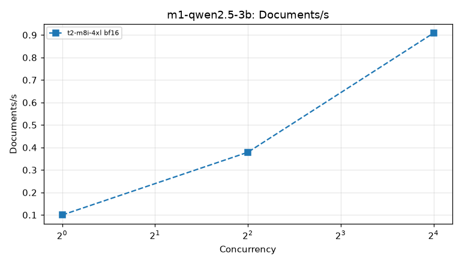

# Benchmark report: smoke-m1-t1-t2 (smoke-m1-t1-t2-20261109T161710Z)

> **SMOKE RUN.** Fewer requests and repeats than the methodology defaults. Use these numbers to check the harness, not to decide.

Suite **standard**, region us-east-1 (use1-az1). Prices are On-Demand from the AWS Price List API; $/unit figures assume the instance is held at that load for a whole hour. Capacity, not cost, decides the verdict.

## m1-qwen2.5-3b

| Target | Instance | Engine | Precision | C | E2E P1/P50/P99 ms | TTFT P1/P50/P99 ms | TPOT P50 ms | Prefill tok/s P50 | Agg tok/s | req/s | err % | $/hr | $/1M tok | AMX | Q delta | SLA |
|---|---|---|---|---|---|---|---|---|---|---|---|---|---|---|---|---|
| t2-m8i-4xl | m8i.4xlarge | vllm | bf16 | 1 | 9,983/10,007/10,042 | 152/166/174 | 77.5 | 779 | 13 | 0.10 | 0.00 | 0.847 | 18.39 | VERIFIED | - | meets |
| t2-m8i-4xl | m8i.4xlarge | vllm | bf16 | 4 | 10,196/10,336/10,405 | 230/324/485 | 78.2 | 401 | 50 | 0.38 | 0.00 | 0.847 | 4.75 | VERIFIED | - | meets |
| t2-m8i-4xl | m8i.4xlarge | vllm | bf16 | 16 | 10,114/12,121/12,184 | 163/1,563/1,616 | 83.2 | 83 | 169 | 0.91 | 0.00 | 0.847 | 1.39 | VERIFIED | - | **cheapest CPU meeting SLA** |

_no GPU row meets the SLA; capacity equivalence not computed_

## Charts

## Price source

- g5.xlarge: $1.006/h, SKU 79BRGEEZC6TARVWJ, effective 2026-11-01T00:00:00Z, price list arn:aws:pricing:::price-list/aws/AmazonEC2/USD/20261107002852/us-east-1 (published 2026-11-07T00:28:52Z)
- g6.xlarge: $0.8048/h, SKU TPKUC6XYSUQ3VFK2, effective 2026-11-01T00:00:00Z, price list arn:aws:pricing:::price-list/aws/AmazonEC2/USD/20261107002852/us-east-1 (published 2026-11-07T00:28:52Z)
- m8i.4xlarge: $0.84672/h, SKU E7HS8NYMC36MBM9V, effective 2026-11-01T00:00:00Z, price list arn:aws:pricing:::price-list/aws/AmazonEC2/USD/20261107002852/us-east-1 (published 2026-11-07T00:28:52Z)

## Capacity errors seen while starting instances

- t1-g6: 2026-11-09T16:17:32Z InsufficientInstanceCapacity (template, None)
- t1-g6: 2026-11-09T16:18:41Z InsufficientInstanceCapacity (template, None)
- t1-g6: 2026-11-09T16:19:55Z InsufficientInstanceCapacity (template, None)
- t1-g6: 2026-11-09T16:21:05Z InsufficientInstanceCapacity (g5.xlarge, None)
- t1-g6: 2026-11-09T16:22:19Z InsufficientInstanceCapacity (template, None)
- t1-g6: 2026-11-09T16:23:31Z InsufficientInstanceCapacity (g5.xlarge, None)
- t1-g6: 2026-11-09T16:24:45Z InsufficientInstanceCapacity (template, None)
- t1-g6: 2026-11-09T16:25:56Z InsufficientInstanceCapacity (g5.xlarge, None)
- t1-g6: 2026-11-09T16:27:11Z InsufficientInstanceCapacity (template, None)
- t1-g6: 2026-11-09T16:28:23Z InsufficientInstanceCapacity (g5.xlarge, None)
- t1-g6: 2026-11-09T16:29:36Z InsufficientInstanceCapacity (template, None)
- t1-g6: 2026-11-09T16:30:47Z InsufficientInstanceCapacity (g5.xlarge, None)
- t1-g6: 2026-11-09T16:31:59Z InsufficientInstanceCapacity (template, None)
- t1-g6: 2026-11-09T16:33:06Z InsufficientInstanceCapacity (g5.xlarge, None)
- t1-g6: 2026-11-09T16:34:17Z InsufficientInstanceCapacity (template, None)
- t1-g6: 2026-11-09T16:35:34Z InsufficientInstanceCapacity (g5.xlarge, None)
- t1-g6: 2026-11-09T16:36:49Z InsufficientInstanceCapacity (template, None)
- t1-g6: 2026-11-09T16:38:00Z InsufficientInstanceCapacity (g5.xlarge, None)
- t1-g6: 2026-11-09T16:39:16Z InsufficientInstanceCapacity (template, None)
- t1-g6: 2026-11-09T16:40:31Z InsufficientInstanceCapacity (g5.xlarge, None)
- t1-g6: 2026-11-09T16:41:48Z InsufficientInstanceCapacity (template, None)
- t1-g6: 2026-11-09T16:43:00Z InsufficientInstanceCapacity (g5.xlarge, None)
- t1-g6: 2026-11-09T16:44:10Z InsufficientInstanceCapacity (template, None)
- t1-g6: 2026-11-09T16:45:26Z InsufficientInstanceCapacity (g5.xlarge, None)
- t1-g6: 2026-11-09T16:46:38Z InsufficientInstanceCapacity (template, None)

## Warnings

- SMOKE RUN: below the methodology defaults (200 requests x 3 repeats per level); numbers are indicative only.
- m1-qwen2.5-3b: license qwen-research is non-commercial; results are for evaluation only.

## Provenance

- run hash 2ac2ba9116a0a31e0863c9227eac7534b573d77dee97a1619f7ccc288e455d22, models 0e7c5b311fde4429defd9403b108f1bd4539ab520b7f60aaf254930628f031a6, targets f062cab64b10cee1db8cd8723dbabfc2925223ff4c560eef063459c58214ecda
- harness commit 0958a9bbf8fc212fb67f1d58656e142453d3358e
- AMIs {"t1-g6": "ami-0fa51b517f148a6a4", "t2-m8i-4xl": "ami-07c1b6f58fb89ce9f"}
- instances {"t2-m8i-4xl": ["i-0cba10f9497a00fd5"]}, market {"t2-m8i-4xl": "on-demand"} (requested on-demand); cost columns use On-Demand prices
