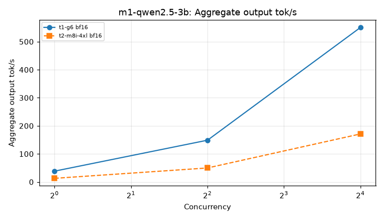
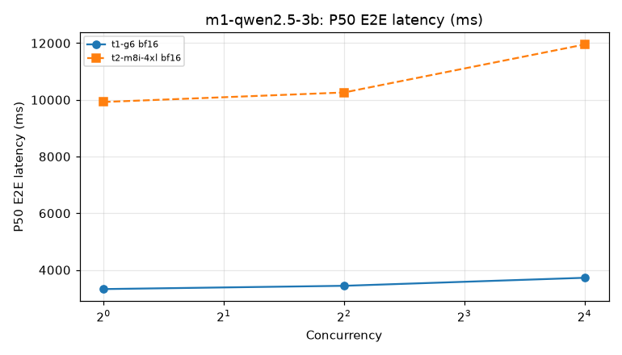
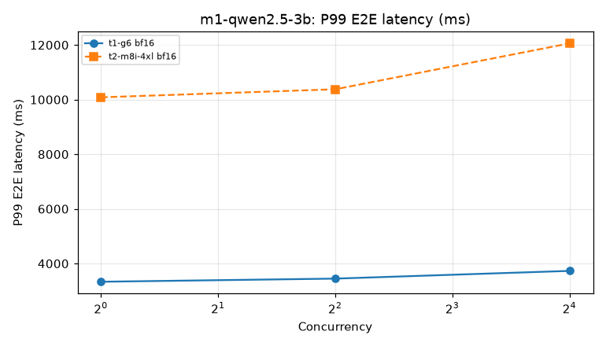
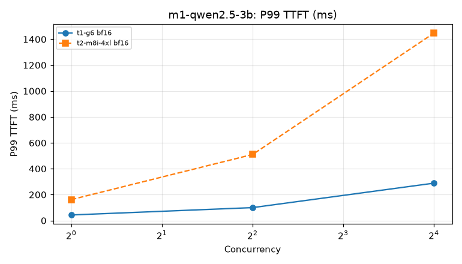
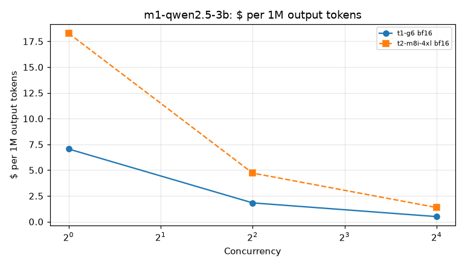

# Benchmark report: smoke-m1-t1-t2 (smoke-m1-t1-t2-20261109T205743Z)

> **SMOKE RUN.** Fewer requests and repeats than the methodology defaults. Use these numbers to check the harness, not to decide.

Suite **standard**, region us-east-1 (use1-az1). Prices are On-Demand from the AWS Price List API; $/unit figures assume the instance is held at that load for a whole hour. Capacity, not cost, decides the verdict.

## m1-qwen2.5-3b

| Target | Instance | Engine | Precision | C | E2E P1/P50/P99 ms | TTFT P1/P50/P99 ms | TPOT P50 ms | Prefill tok/s P50 | Agg tok/s | req/s | err % | $/hr | $/1M tok | AMX | Q delta | SLA |
|---|---|---|---|---|---|---|---|---|---|---|---|---|---|---|---|---|
| t1-g6 | g6.2xlarge | vllm | bf16 | 1 | 3,316/3,326/3,333 | 40/42/43 | 25.9 | 3,094 | 38 | 0.30 | 0.00 | 0.978 | 7.06 | n/a | - | meets |
| t1-g6 | g6.2xlarge | vllm | bf16 | 4 | 3,393/3,441/3,448 | 44/96/100 | 26.3 | 1,356 | 149 | 1.09 | 0.00 | 0.978 | 1.82 | n/a | - | meets |
| t1-g6 | g6.2xlarge | vllm | bf16 | 16 | 3,386/3,724/3,730 | 46/282/289 | 27.1 | 460 | 551 | 2.97 | 0.00 | 0.978 | 0.49 | n/a | - | **best GPU** |
| t2-m8i-4xl | m8i.4xlarge | vllm | bf16 | 1 | 9,876/9,925/10,083 | 141/149/162 | 77.0 | 871 | 13 | 0.10 | 0.00 | 0.847 | 18.28 | VERIFIED | 0.216 | meets |
| t2-m8i-4xl | m8i.4xlarge | vllm | bf16 | 4 | 9,972/10,260/10,377 | 153/455/510 | 77.1 | 285 | 50 | 0.37 | 0.00 | 0.847 | 4.72 | VERIFIED | 0.216 | meets |
| t2-m8i-4xl | m8i.4xlarge | vllm | bf16 | 16 | 9,985/11,953/12,058 | 189/1,445/1,448 | 82.7 | 90 | 171 | 0.92 | 0.00 | 0.847 | 1.37 | VERIFIED | 0.216 | **cheapest CPU meeting SLA** |

Capacity equivalence (CPU instances needed to match the best GPU row's SLA-meeting throughput):

| CPU instance | Engine | Precision | C | Instances per GPU | Standard vCPUs | G vCPUs (GPU) | Hourly cost ratio | Within limit |
|---|---|---|---|---|---|---|---|---|
| m8i.4xlarge | vllm | bf16 | 1 | 43 | 688 | 8 | 37.24 | no (Conditional) |
| m8i.4xlarge | vllm | bf16 | 16 | 4 | 64 | 8 | 3.46 | yes |
| m8i.4xlarge | vllm | bf16 | 4 | 12 | 192 | 8 | 10.39 | no (Conditional) |

## Charts

## Price source

- g5.xlarge: $1.006/h, SKU 79BRGEEZC6TARVWJ, effective 2026-11-01T00:00:00Z, price list arn:aws:pricing:::price-list/aws/AmazonEC2/USD/20261107002852/us-east-1 (published 2026-11-07T00:28:52Z)
- g6.2xlarge: $0.9776/h, SKU XCA3J9EEM739PU6M, effective 2026-11-01T00:00:00Z, price list arn:aws:pricing:::price-list/aws/AmazonEC2/USD/20261107002852/us-east-1 (published 2026-11-07T00:28:52Z)
- g6.xlarge: $0.8048/h, SKU TPKUC6XYSUQ3VFK2, effective 2026-11-01T00:00:00Z, price list arn:aws:pricing:::price-list/aws/AmazonEC2/USD/20261107002852/us-east-1 (published 2026-11-07T00:28:52Z)
- m8i.4xlarge: $0.84672/h, SKU E7HS8NYMC36MBM9V, effective 2026-11-01T00:00:00Z, price list arn:aws:pricing:::price-list/aws/AmazonEC2/USD/20261107002852/us-east-1 (published 2026-11-07T00:28:52Z)

## Capacity errors seen while starting instances

- t1-g6: 2026-11-09T20:58:05Z InsufficientInstanceCapacity (g6.xlarge, None)
- t1-g6: 2026-11-09T20:59:14Z InsufficientInstanceCapacity (g6.xlarge, None)
- t1-g6: 2026-11-09T21:00:31Z InsufficientInstanceCapacity (g6.xlarge, None)
- t1-g6: 2026-11-09T21:01:44Z InsufficientInstanceCapacity (g5.xlarge, None)
- t1-g6: 2026-11-09T21:02:58Z InsufficientInstanceCapacity (g6.2xlarge, None)
- t1-g6: 2026-11-09T21:04:14Z InsufficientInstanceCapacity (g6.xlarge, None)
- t1-g6: 2026-11-09T21:05:24Z InsufficientInstanceCapacity (g5.xlarge, None)

## Warnings

- SMOKE RUN: below the methodology defaults (200 requests x 3 repeats per level); numbers are indicative only.
- m1-qwen2.5-3b: license qwen-research is non-commercial; results are for evaluation only.

## Provenance

- run hash a298b2fdcc2fde08c5a6203834086ebcb1a05d79ce8e417201bfc4470429d592, models 0e7c5b311fde4429defd9403b108f1bd4539ab520b7f60aaf254930628f031a6, targets f062cab64b10cee1db8cd8723dbabfc2925223ff4c560eef063459c58214ecda
- harness commit bcb23473c69abc40d7155385b49cf5e3a6dad754
- AMIs {"t1-g6": "ami-0fa51b517f148a6a4", "t2-m8i-4xl": "ami-07c1b6f58fb89ce9f"}
- instances {"t1-g6": ["i-0fc36ee7f7213317d"], "t2-m8i-4xl": ["i-0cba10f9497a00fd5"]}, market {"t1-g6": "spot", "t2-m8i-4xl": "on-demand"} (requested spot); cost columns use On-Demand prices
- pairing t2-m8i-4xl (m8i.4xlarge) vs t1-g6 (g6.2xlarge): fair, GPU/CPU hourly price ratio 1.155
